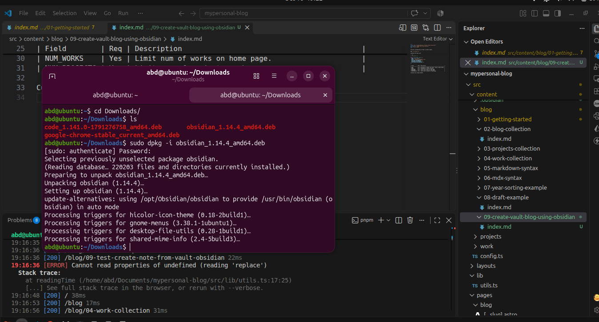

The basic configuration of Nano is pretty simple.

Edit `src/consts.ts`

Customize the base site

```ts
// src/consts.ts

export const SITE: Site = {
  NAME: "Astro Nano",
  EMAIL: "markhorn.dev@gmail.com",
  NUM_POSTS_ON_HOMEPAGE: 3,
  NUM_WORKS_ON_HOMEPAGE: 2,
  NUM_PROJECTS_ON_HOMEPAGE: 3,
};
```

| Field        | Req | Description                                          |
| :----------- | :-- | :--------------------------------------------------- |
| NAME         | Yes | Displayed in header and footer. Used in SEO and RSS. |
| EMAIL        | Yes | Displayed in contact section.                        |
| NUM_POSTS    | Yes | Limit num of posts on home page.                     |
| NUM_WORKS    | Yes | Limit num of works on home page.                     |
| NUM_PROJECTS | Yes | Limit num of projects on home page.                  |

Customize your page metadata


